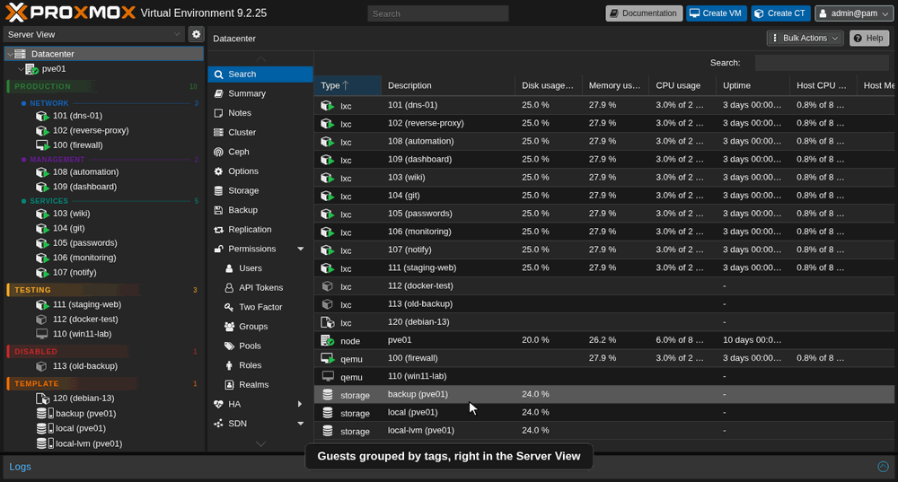
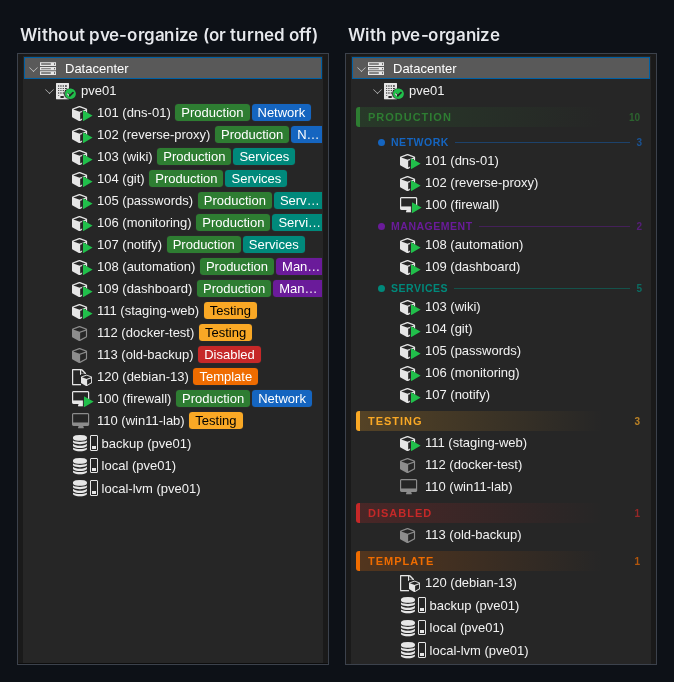
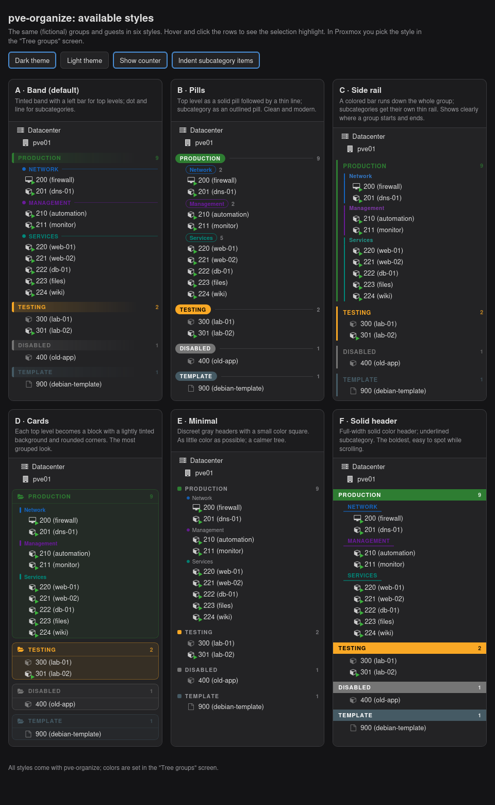
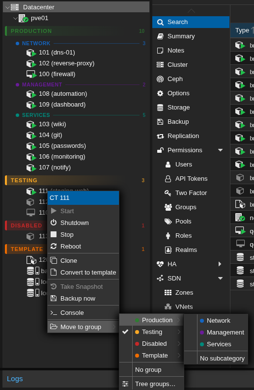
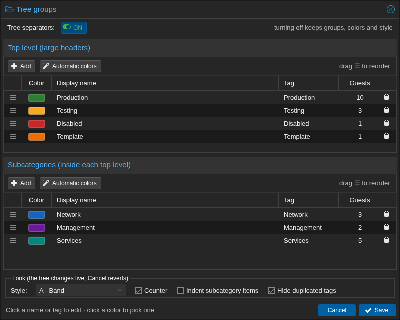
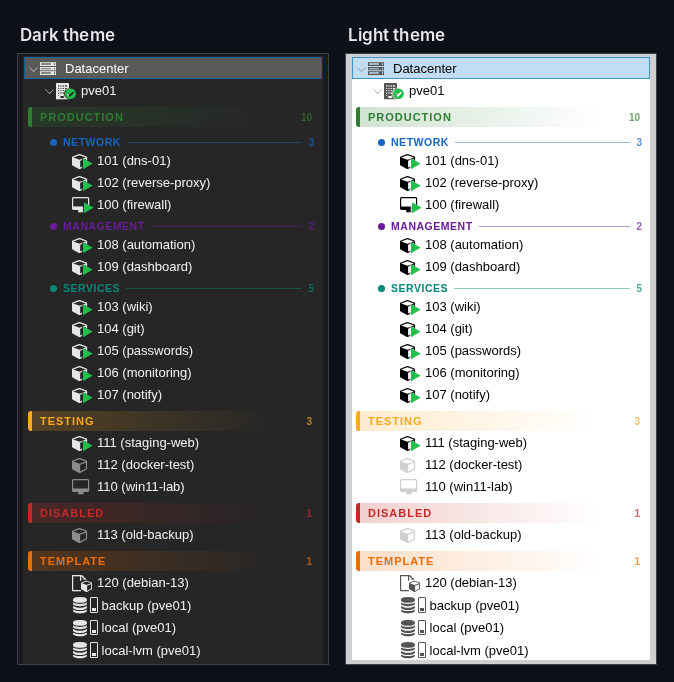
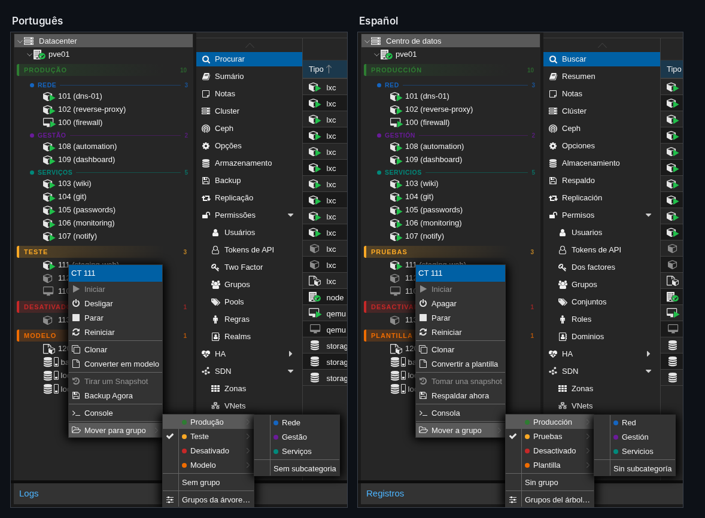
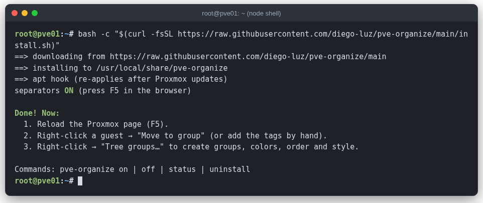
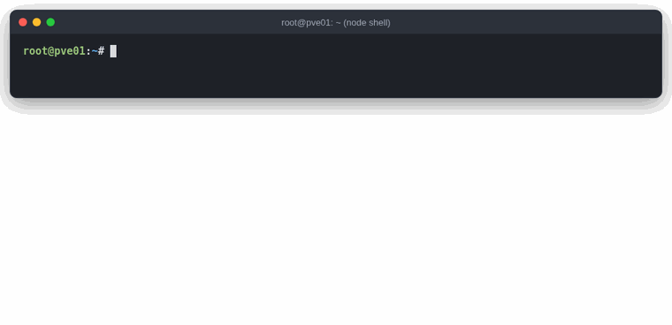

<div align="center">


**Grupos y separadores en el árbol de Proxmox VE.**

[](LICENSE)


[English](README.md) · [Português (Brasil)](README.pt-BR.md) · **Español**

</div>

> Organiza tus VMs y contenedores en secciones de colores — como *Producción › Red*,
> *Pruebas*, *Plantilla* — directamente en la Server View, con una pantalla para elegir
> colores, orden y estilo.



<sub>Todas las imágenes y animaciones usan un laboratorio ficticio (nodo `pve01`), no un servidor real.</sub>

- **Dos niveles**: un *nivel superior* (título grande) y, si quieres, una *subcategoría*
  (subtítulo) por servidor.
- **Usa las etiquetas de Proxmox**, nada nuevo guardado en los servidores. Un servidor con
  `Produccion;Red` aparece en **PRODUCCIÓN › Red**.
- **Clic derecho → Mover a grupo** cambia el grupo en dos clics.
- **Pantalla Grupos del árbol…**: crear grupos, elegir colores (o automáticos), arrastrar para
  ordenar, 6 estilos, contador, sangría y un interruptor de encendido/apagado.
- **Configuración compartida**: se guarda en las Notas del Datacenter y en Tag Style, así todos
  los administradores y navegadores ven el mismo árbol.
- **Sigue el idioma de Proxmox**: español, inglés y portugués (los demás usan inglés).
- **Sobrevive a las actualizaciones de Proxmox** y se quita con un comando.

> Proyecto de la comunidad, sin relación con Proxmox Server Solutions GmbH.

## Imágenes

**Antes y después** — el árbol estándar con etiquetas, y los mismos guests con pve-organize:



**Los seis estilos** (elige uno en *Grupos del árbol…*):



**Clic derecho → Mover a grupo:**



**Pantalla Grupos del árbol…** — colores, orden, estilo y el botón ACTIVADOS/DESACTIVADOS:



**Tema oscuro y claro:**



**Sigue el idioma de Proxmox** (portugués y español):



---

## ¿Por qué no la Tag View o los pools?

Proxmox VE ya tiene la **Tag View** (desde 8.3) y la **Pool View**, y existen mods de la comunidad
que crean carpetas. Resuelven problemas parecidos; pve-organize apunta a otro: mantener la
**Server View** que ya usas, pero organizada.

| | pve-organize | Tag View | Pool View | Mods que reemplazan `pvemanagerlib.js` |
|---|:-:|:-:|:-:|:-:|
| Sigue en la Server View (agrupada por nodo) | ✅ | ❌ | ❌ | depende |
| Cada guest aparece en un solo lugar | ✅ | ❌ (una vez por etiqueta) | ✅ | depende |
| Dos niveles (grupo › subgrupo) | ✅ | ❌ | ❌ | ✅ |
| Colores en encabezados, orden propio, estilos | ✅ | ❌ | ❌ | ❌ |
| Pantalla de configuración en la interfaz web | ✅ | — | — | ❌ |
| Configuración válida para todo el clúster | ✅ | ✅ | ✅ | ✅ (etiquetas) |
| No modifica archivos de Proxmox | ✅ (inyecta un script) | ✅ | ✅ | ❌ |
| Sobrevive a `apt upgrade` | ✅ (vigilante + hook de apt) | ✅ | ✅ | normalmente ❌ |
| Oficial / soportado por Proxmox | ❌ | ✅ | ✅ | ❌ |

Si necesitas permisos por grupo, usa **pools** — pve-organize es solo visual y se puede usar
junto con ellos.

## Instalar

Los comandos se ejecutan **en el propio nodo de Proxmox, como `root`**, no en tu computadora.
Abre una terminal en el nodo de una de estas formas:

- **Interfaz web**: selecciona el nodo (p. ej. `pve`) en el árbol → **>_ Shell**.
- **SSH**: `ssh root@<ip-del-nodo>` desde tu computadora.

En esa terminal, ejecuta:

```bash
bash -c "$(curl -fsSL https://github.com/diego-luz/pve-organize/releases/latest/download/install.sh)"
```

Esto instala la última [versión publicada](https://github.com/diego-luz/pve-organize/releases).
Antes de instalar, el script verifica cada archivo descargado con el `SHA256SUMS` de la versión
y se detiene si algo no coincide.

<details>
<summary>Una versión específica, o la versión en desarrollo</summary>

```bash
# una versión específica (p. ej. para volver a una anterior)
bash -c "$(curl -fsSL https://github.com/diego-luz/pve-organize/releases/download/v1.0.3/install.sh)"
# versión en desarrollo, de la rama main (sin verificación de checksum)
REF=main bash -c "$(curl -fsSL https://raw.githubusercontent.com/diego-luz/pve-organize/main/install.sh)"
```
</details>

Luego vuelve a la página de Proxmox en el **navegador** y recárgala (**F5**).



<details>
<summary>Descargar los archivos primero, verificarlos y luego instalar (en la misma terminal del nodo)</summary>

```bash
mkdir -p ~/pve-organize && cd ~/pve-organize
for f in install.sh pve-organize pve-organize.js SHA256SUMS; do
    curl -fsSLO https://github.com/diego-luz/pve-organize/releases/latest/download/$f
done
sha256sum -c SHA256SUMS     # todas las líneas deben decir OK
less install.sh             # opcional: leer qué hace (q para salir)
bash install.sh             # instala los archivos de esta carpeta
```
</details>

<details>
<summary>Instalar desde un clon (en la misma terminal del nodo)</summary>

```bash
apt install -y git          # si git aún no está instalado
git clone https://github.com/diego-luz/pve-organize.git
cd pve-organize
git checkout "$(git describe --tags --abbrev=0)"   # última versión (omítelo para usar la rama main)
./install.sh
```
</details>

### Versiones probadas

| Proxmox VE | pve-manager | proxmox-widget-toolkit | Kernel | Resultado |
|---|---|---|---|---|
| **9.2** | 9.2.25 | 5.2.10 | 7.0.14-26-pve | ✅ funciona (tema oscuro y claro; interfaz en inglés, portugués y español) |
| **8.4** | 8.4.21 | — | 6.8.12-43-pve | ✅ funciona (clúster de 3 nodos: grupos, Mover a grupo, renombrar grupos, servidor bloqueado) |
| 8.0–8.3 | — | — | — | ⚠️ no probado; el instalador lo permite y avisa |

Las versiones anteriores a la 8 son rechazadas por el instalador. Si lo pruebas en otra versión,
abre un issue contando si funcionó. En un clúster, instálalo en cada nodo cuya interfaz web uses.

## Uso

1. **Pon los servidores en grupos.** Clic derecho en la VM/CT → **Mover a grupo** →
   *Producción* → *Red*. O pon las etiquetas a mano (una de nivel superior y, si quieres, una de
   subcategoría).
2. **Ajusta.** Clic derecho en un servidor, en el nodo o en *Datacenter* → **Grupos del árbol…**

| En la pantalla *Grupos del árbol* | |
|---|---|
| **Añadir** | escribe el nombre; la etiqueta se crea a partir de él (sin tildes ni espacios) |
| **Color** | haz clic en la muestra para abrir el selector, o usa **Colores automáticos** |
| **Orden** | arrastra por ☰; el orden de la lista es el orden del árbol |
| **Servidores** | cuántos usan cada grupo; renombrar la etiqueta actualiza esos servidores |
| **Apariencia** | estilo A–F, contador, sangría, ocultar etiquetas repetidas — el árbol cambia al instante; *Cancel* deshace |
| **ACTIVADOS / DESACTIVADOS** | botón arriba: activa o desactiva al instante, sin perder nada |

Los servidores sin una etiqueta de nivel superior conocida aparecen al final, en **Sin grupo**.

## Comandos

En la terminal del nodo (**>_ Shell** de la interfaz web o SSH), como `root`:

```bash
pve-organize status        # versión, activado/desactivado, script en la interfaz, hook de apt, vigilante, versión de Proxmox
pve-organize version       # versión instalada
pve-organize off           # lo quita de la interfaz (la configuración se conserva)
pve-organize on            # lo carga de nuevo
pve-organize desinstalar   # quita todo lo instalado (también: uninstall)
```



## Cómo funciona

- `/usr/local/share/pve-organize/pve-organize.js` se copia a `/usr/share/pve-manager/js/` y se
  añade una línea `<script>` a `/usr/share/pve-manager/index.html.tpl`. Una copia limpia de esa
  página queda en `/usr/local/share/pve-organize/index.html.tpl.original`.
- Un vigilante de systemd (`pve-organize-vigia.path`) vuelve a poner la línea segundos después de
  que una actualización de Proxmox reemplace esa página, y un hook de apt
  (`/etc/apt/apt.conf.d/99pve-organize`) lo comprueba otra vez al final de la actualización.
  Los mensajes van al journal: `journalctl -t pve-organize`.
- Grupos, orden y estilo se guardan en un bloque oculto al final de **Datacenter → Notas**
  (`<!-- pve-organize … -->`); los colores en **Datacenter → Opciones → Tag Style**.
  No edites ese bloque a mano; el resto de tus notas no se toca.
- Solo cambia la interfaz web. Mover un servidor solo cambia sus etiquetas.
- Funciona con **Tag Style → case-sensitive** activado o desactivado. Desactivado (el valor por
  defecto de Proxmox), Proxmox guarda las etiquetas en minúsculas (`Produccion` pasa a `produccion`);
  grupos y colores siguen coincidiendo. No se permiten dos grupos cuyas etiquetas solo difieren en
  mayúsculas (`Pruebas` y `PRUEBAS`).
- Renombrar la etiqueta de un grupo actualiza todos los servidores que la usan. Un servidor
  bloqueado (backup, snapshot, migración) o en un nodo caído se queda con la etiqueta antigua y
  aparece en **Sin grupo**; la pantalla lista esos servidores al final. Muévelos con **Mover a
  grupo** cuando estén libres.

Permisos: mover un servidor requiere `VM.Config.Options` en él; guardar la pantalla
*Grupos del árbol* requiere `Sys.Modify` en `/`.

## Actualizar y desinstalar

- **Actualizar**: ejecuta de nuevo el comando de instalación (siempre obtiene la última versión).
  Qué cambió en cada versión: [CHANGELOG.md](CHANGELOG.md).
- **Desinstalar**: `pve-organize desinstalar` y F5. Los grupos siguen en las Notas del Datacenter
  y en Tag Style; bórralos allí si quieres.
- **¿Algo se ve raro?** `pve-organize off` y F5 devuelven el árbol original de Proxmox.

### Después de una actualización de Proxmox

Una actualización del paquete `pve-manager` reemplaza la página de la interfaz de Proxmox, y el
complemento desaparece por un momento. **No hace falta reinstalar:** el vigilante lo vuelve a poner
en segundos (antes de la 1.0.3 solo ocurría cuando `apt` terminaba todo, lo que puede tardar minutos).

- ¿Los grupos desaparecieron tras actualizar? Espera a que termine la actualización y pulsa **Ctrl+F5**.
- ¿Siguen sin aparecer? Ejecuta `pve-organize status`, luego `pve-organize on`, y mira
  `journalctl -t pve-organize`: si una versión nueva de Proxmox cambió la página, el error está ahí.

## Traducciones

Los textos están en la tabla `TEXTOS` al inicio de `pve-organize.js` (una línea por texto:
portugués, inglés, español). Se aceptan pull requests con más idiomas.

## Licencia

[MIT](LICENSE)
