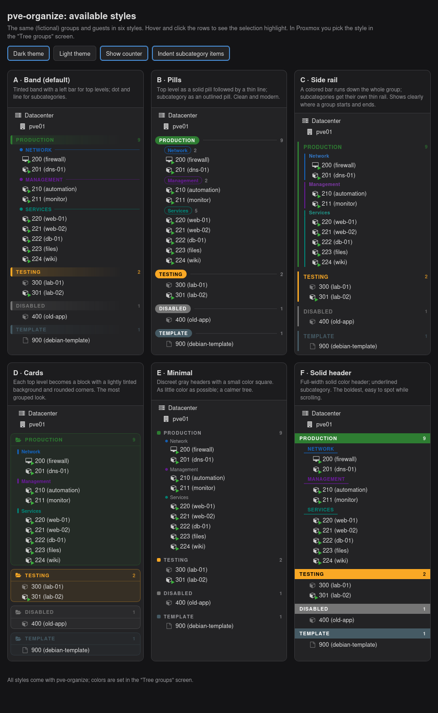

# PVE Organize

**Groups and separators for the Proxmox VE resource tree.** Organize your VMs and containers
into colored sections — like *Production › Network*, *Testing*, *Template* — right inside the
Server View, with a settings screen for colors, order and style.

**English** · [Português (Brasil)](README.pt-BR.md) · [Español](README.es.md)

[](LICENSE)




- **Two levels**: a *top level* (big header) and an optional *subcategory* (small header) per guest.
- **Uses Proxmox tags** — nothing new to store on the guests. A guest tagged `Production;Network`
  shows up under **PRODUCTION › Network**.
- **Right-click → Move to group** to change a guest's group in two clicks.
- **Tree groups… screen**: add groups, pick colors (or let it choose them), drag to reorder,
  choose one of 6 styles, counter, indentation, and an on/off switch.
- **Settings are shared**: stored in the Datacenter Notes and Tag Style, so every admin and
  every browser sees the same tree.
- **Follows the Proxmox language**: English, Português and Español (others fall back to English).
- **Survives Proxmox updates** and is removed with a single command.

> Community project, not affiliated with Proxmox Server Solutions GmbH.

---

## Install

The commands run **on the Proxmox node itself, as `root`** — not on your own computer.
Open a shell on the node in one of these ways:

- **Web UI**: select the node (e.g. `pve`) in the tree → **>_ Shell**.
- **SSH**: `ssh root@<node-ip>` from your computer.

In that shell, run:

```bash
bash -c "$(curl -fsSL https://raw.githubusercontent.com/diego-luz/pve-organize/main/install.sh)"
```

Then go back to the Proxmox page in your **browser** and reload it (**F5**).

<details>
<summary>Install from a clone instead (same shell on the node)</summary>

```bash
apt install -y git          # if git is not installed yet
git clone https://github.com/diego-luz/pve-organize.git
cd pve-organize
./install.sh
```
</details>

### Tested versions

| Proxmox VE | pve-manager | proxmox-widget-toolkit | Kernel | Result |
|---|---|---|---|---|
| **9.2** | 9.2.25 | 5.2.10 | 7.0.14-26-pve | ✅ works (tested with the dark theme and the Portuguese UI) |
| 8.x | — | — | — | ⚠️ not tested; the installer allows it and warns |

Older than 8 is refused by the installer. If you try it on another version, please open an
issue saying whether it worked. In a cluster, install it on every node whose web UI you use.

## Use

1. **Put guests in groups.** Right-click a VM/CT → **Move to group** → *Production* → *Network*.
   Or set the tags by hand (one top-level tag and, optionally, one subcategory tag).
2. **Tune it.** Right-click any guest, the node or *Datacenter* → **Tree groups…**

| In the *Tree groups* screen | |
|---|---|
| **Add** | type a name; the tag is created from it (accents and spaces removed) |
| **Color** | click the swatch to open the color picker, or **Automatic colors** |
| **Order** | drag the ☰ handle; the list order is the tree order |
| **Guests** | how many guests use each group; renaming a tag updates those guests |
| **Look** | style A–F, counter, indent, hide duplicated tags — the tree updates live; *Cancel* reverts |
| **ON / OFF** | top button: turns the separators off or on immediately, keeping all settings |

Guests without a known top-level tag appear at the end, under **No group**.

## Commands

In the node's shell (web UI **>_ Shell** or SSH), as `root`:

```bash
pve-organize status      # on / off
pve-organize off         # remove from the web UI (settings are kept)
pve-organize on          # load it again
pve-organize uninstall   # remove everything that was installed
```

## How it works

- `/usr/local/share/pve-organize/pve-organize.js` is copied to `/usr/share/pve-manager/js/`
  and one `<script>` line is added to `/usr/share/pve-manager/index.html.tpl`.
  A clean copy of that page is kept in `/usr/local/share/pve-organize/index.html.tpl.original`.
- An apt hook (`/etc/apt/apt.conf.d/99pve-organize`) puts the line back after Proxmox updates.
- Groups, order and style live in a hidden block at the end of **Datacenter → Notes**
  (`<!-- pve-organize … -->`); colors live in **Datacenter → Options → Tag Style**.
  Don't edit that block by hand; the rest of your notes is left alone.
- It only changes the web UI. Moving a guest only edits its tags.

Permissions: moving a guest needs `VM.Config.Options` on it; saving the *Tree groups* screen
needs `Sys.Modify` on `/`.

## Update and uninstall

- **Update**: run the install command again.
- **Uninstall**: `pve-organize uninstall`, then F5. Your groups stay in the Datacenter Notes and
  Tag Style; delete them there if you want.
- **Something looks wrong?** `pve-organize off` and F5 brings back the stock Proxmox tree.

## Translations

UI texts are in the `TEXTOS` table at the top of `pve-organize.js` (one line per text:
Portuguese, English, Spanish). Pull requests with more languages are welcome.

## License

[MIT](LICENSE)
