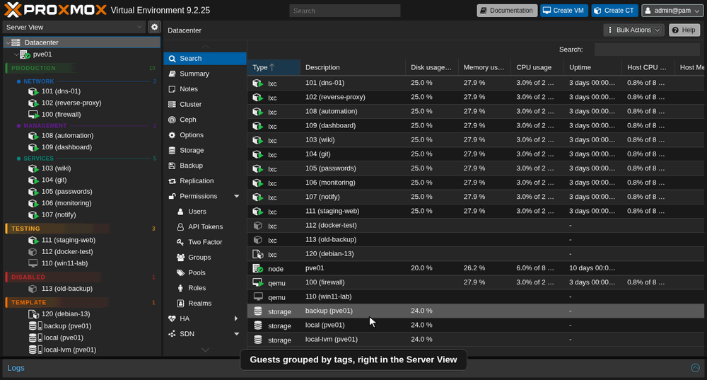
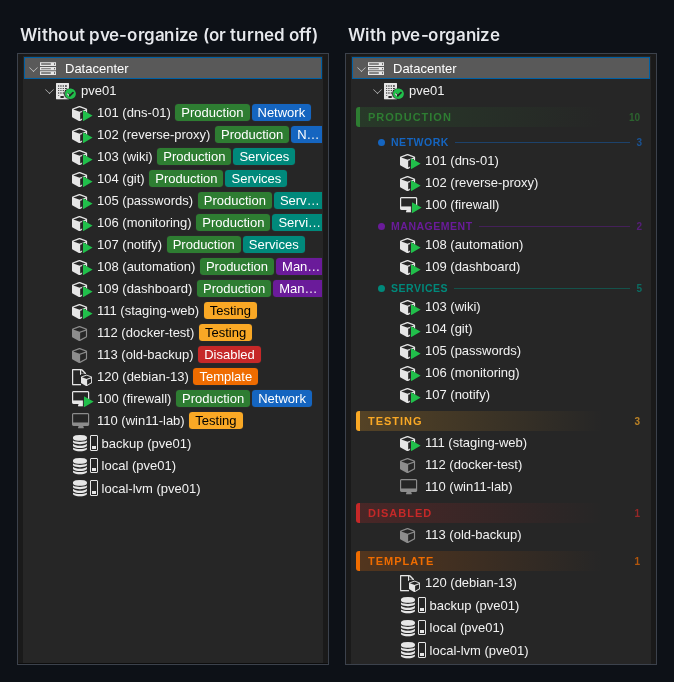
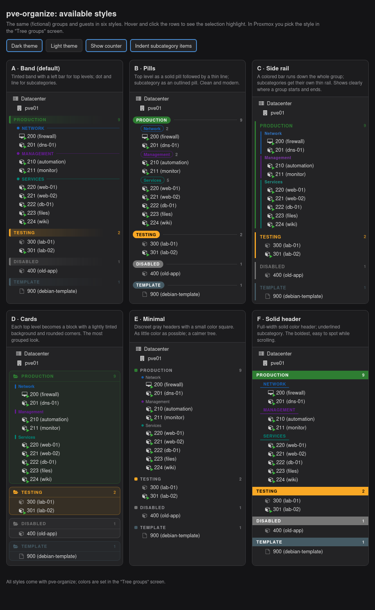
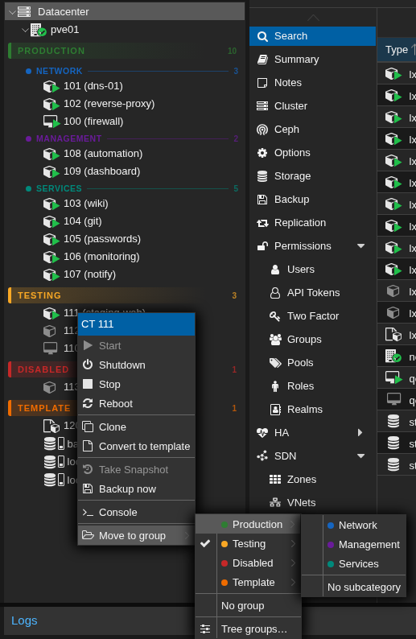
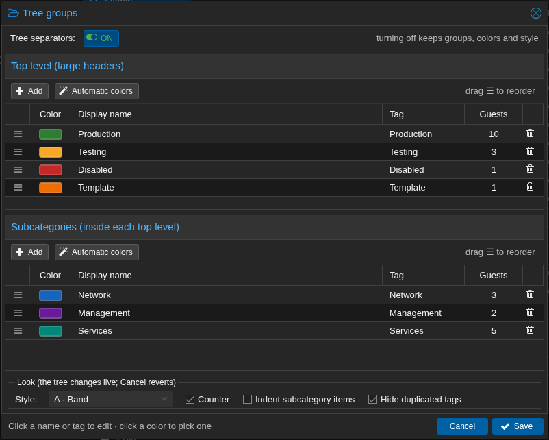
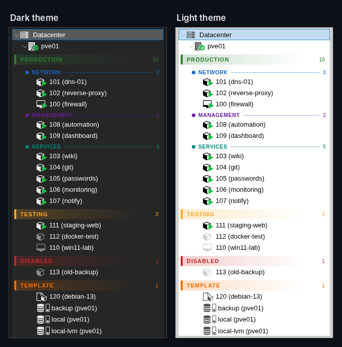
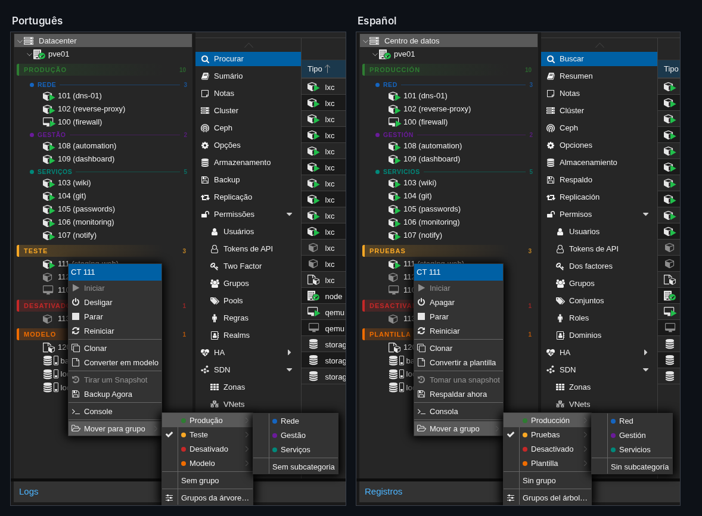
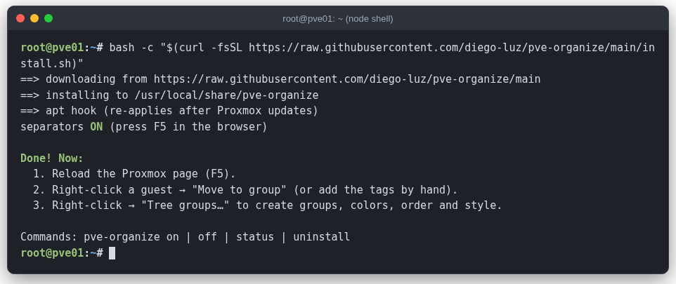
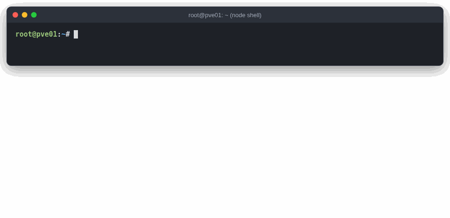

<div align="center">


**Grupos e separadores na árvore do Proxmox VE.**

[](LICENSE)


[English](README.md) · **Português (Brasil)** · [Español](README.es.md)

</div>

> Organize VMs e containers em seções coloridas — como *Produção › Rede*, *Teste*,
> *Modelo* — direto na Server View, com uma tela para escolher cores, ordem e estilo.



<sub>Todas as imagens e animações usam um laboratório fictício (nó `pve01`), não um servidor real.</sub>

- **Dois níveis**: um *topo* (título grande) e, se quiser, uma *subcategoria* (subtítulo) por servidor.
- **Usa as tags do Proxmox**, nada novo guardado nos servidores. Um servidor com as tags
  `Producao;Rede` aparece em **PRODUÇÃO › Rede**.
- **Botão direito → Mover para grupo** troca o grupo em dois cliques.
- **Tela Grupos da árvore…**: criar grupos, escolher cores (ou deixar automático), arrastar para
  ordenar, 6 estilos, contador, recuo e um botão de liga/desliga.
- **Configuração compartilhada**: fica nas Notas do Datacenter e no Tag Style, então todos os
  administradores e navegadores veem a mesma árvore.
- **Segue o idioma do Proxmox**: português, inglês e espanhol (os outros caem no inglês).
- **Continua depois das atualizações do Proxmox** e sai com um comando.

> Projeto da comunidade, sem ligação com a Proxmox Server Solutions GmbH.

## Imagens

**Antes e depois** — a árvore padrão com as tags, e os mesmos guests com o pve-organize:



**Os seis estilos** (escolha um em *Grupos da árvore…*):



**Botão direito → Mover para grupo:**



**Tela Grupos da árvore…** — cores, ordem, estilo e o botão LIGADOS/DESLIGADOS:



**Tema escuro e claro:**



**Segue o idioma do Proxmox** (português e espanhol):



---

## Por que não a Tag View ou os pools?

O Proxmox VE já tem a **Tag View** (desde o 8.3) e a **Pool View**, e existem mods da comunidade
que criam pastas. Eles resolvem problemas parecidos; o pve-organize mira outro: manter a
**Server View** que você já usa, só que organizada.

| | pve-organize | Tag View | Pool View | Mods que substituem o `pvemanagerlib.js` |
|---|:-:|:-:|:-:|:-:|
| Continua na Server View (agrupada por nó) | ✅ | ❌ | ❌ | varia |
| Cada guest aparece em um único lugar | ✅ | ❌ (uma vez por tag) | ✅ | varia |
| Dois níveis (grupo › subgrupo) | ✅ | ❌ | ❌ | ✅ |
| Cores nos cabeçalhos, ordem própria, estilos | ✅ | ❌ | ❌ | ❌ |
| Tela de configuração na interface web | ✅ | — | — | ❌ |
| Configuração vale para o cluster inteiro | ✅ | ✅ | ✅ | ✅ (tags) |
| Não altera arquivos do Proxmox | ✅ (injeta um script) | ✅ | ✅ | ❌ |
| Sobrevive ao `apt upgrade` | ✅ (hook do apt) | ✅ | ✅ | geralmente ❌ |
| Oficial / suportado pela Proxmox | ❌ | ✅ | ✅ | ❌ |

Se você precisa de permissões por grupo, use **pools** — o pve-organize é só visual e pode ser
usado junto com eles.

## Instalar

Os comandos rodam **no próprio nó do Proxmox, como `root`**, e não no seu computador.
Abra um terminal no nó de um destes jeitos:

- **Pela interface web**: selecione o nó (ex.: `pve`) na árvore → **>_ Shell**.
- **Por SSH**: `ssh root@<ip-do-nó>` a partir do seu computador.

Nesse terminal, rode:

```bash
bash -c "$(curl -fsSL https://github.com/diego-luz/pve-organize/releases/latest/download/install.sh)"
```

Isso instala a última [versão publicada](https://github.com/diego-luz/pve-organize/releases).
Antes de instalar, o script confere cada arquivo baixado com o `SHA256SUMS` da versão e para
se algo não bater.

<details>
<summary>Uma versão específica, ou a versão em desenvolvimento</summary>

```bash
# uma versão específica (ex.: para voltar a uma anterior)
bash -c "$(curl -fsSL https://github.com/diego-luz/pve-organize/releases/download/v1.0.1/install.sh)"
# versão em desenvolvimento, da branch main (sem conferência de checksum)
REF=main bash -c "$(curl -fsSL https://raw.githubusercontent.com/diego-luz/pve-organize/main/install.sh)"
```
</details>

Depois volte para a página do Proxmox no **navegador** e recarregue (**F5**).



<details>
<summary>Baixar os arquivos primeiro, conferir e depois instalar (no mesmo terminal do nó)</summary>

```bash
mkdir -p ~/pve-organize && cd ~/pve-organize
for f in install.sh pve-organize pve-organize.js SHA256SUMS; do
    curl -fsSLO https://github.com/diego-luz/pve-organize/releases/latest/download/$f
done
sha256sum -c SHA256SUMS     # todas as linhas precisam dizer OK
less install.sh             # opcional: ler o que ele faz (q para sair)
bash install.sh             # instala os arquivos desta pasta
```
</details>

<details>
<summary>Instalar a partir de um clone (no mesmo terminal do nó)</summary>

```bash
apt install -y git          # se o git ainda não estiver instalado
git clone https://github.com/diego-luz/pve-organize.git
cd pve-organize
git checkout "$(git describe --tags --abbrev=0)"   # última versão (pule para usar a branch main)
./install.sh
```
</details>

### Versões testadas

| Proxmox VE | pve-manager | proxmox-widget-toolkit | Kernel | Resultado |
|---|---|---|---|---|
| **9.2** | 9.2.25 | 5.2.10 | 7.0.14-26-pve | ✅ funciona (tema escuro e claro; interface em inglês, português e espanhol) |
| **8.4** | 8.4.21 | — | 6.8.12-43-pve | ✅ funciona (cluster de 3 nós: grupos, Mover para grupo, renomear grupos, servidor travado) |
| 8.0–8.3 | — | — | — | ⚠️ não testado; o instalador permite e avisa |

Versões anteriores à 8 são recusadas pelo instalador. Se testar em outra versão, abra uma
issue contando se funcionou. Em cluster, instale em cada nó cuja interface web você usa.

## Usar

1. **Coloque os servidores em grupos.** Botão direito na VM/CT → **Mover para grupo** →
   *Produção* → *Rede*. Ou coloque as tags à mão (uma de topo e, se quiser, uma de subcategoria).
2. **Ajuste.** Botão direito num servidor, no nó ou no *Datacenter* → **Grupos da árvore…**

| Na tela *Grupos da árvore* | |
|---|---|
| **Adicionar** | digite o nome; a tag é criada a partir dele (sem acento e sem espaço) |
| **Cor** | clique no quadradinho para abrir o seletor, ou use **Cores automáticas** |
| **Ordem** | arraste pelo ☰; a ordem da lista é a ordem na árvore |
| **Servidores** | quantos usam cada grupo; renomear a tag atualiza esses servidores |
| **Visual** | estilo A–F, contador, recuo, esconder tags repetidas — a árvore muda na hora; *Cancel* desfaz |
| **LIGADOS / DESLIGADOS** | botão no topo: liga ou desliga na hora, sem perder nada |

Servidores sem uma tag de topo conhecida aparecem no fim, em **Sem grupo**.

## Comandos

No terminal do nó (**>_ Shell** da interface web ou SSH), como `root`:

```bash
pve-organize status        # versão, ligado/desligado, script na interface, hook do apt, versão do Proxmox
pve-organize version       # versão instalada
pve-organize off           # tira da interface (a configuração fica salva)
pve-organize on            # carrega de novo
pve-organize desinstalar   # remove tudo o que foi instalado
```



## Como funciona

- `/usr/local/share/pve-organize/pve-organize.js` é copiado para `/usr/share/pve-manager/js/`
  e uma linha `<script>` entra em `/usr/share/pve-manager/index.html.tpl`. Uma cópia limpa dessa
  página fica em `/usr/local/share/pve-organize/index.html.tpl.original`.
- Um hook do apt (`/etc/apt/apt.conf.d/99pve-organize`) recoloca a linha depois das
  atualizações do Proxmox.
- Grupos, ordem e estilo ficam num bloco escondido no fim de **Datacenter → Notas**
  (`<!-- pve-organize … -->`); as cores ficam em **Datacenter → Opções → Tag Style**.
  Não edite esse bloco à mão; o resto das suas notas não é tocado.
- Só muda a interface web. Mover um servidor só altera as tags dele.
- Funciona com **Tag Style → case-sensitive** ligado ou desligado. Desligado (o padrão do Proxmox),
  o Proxmox grava as tags em minúsculas (`Producao` vira `producao`); grupos e cores continuam
  batendo. Dois grupos com tags que só diferem em maiúsculas (`Teste` e `TESTE`) não são aceitos.
- Renomear a tag de um grupo atualiza todos os servidores que a usam. Um servidor travado (backup,
  snapshot, migração) ou num nó fora do ar fica com a tag antiga e aparece em **Sem grupo**; a tela
  lista esses servidores no fim. Mova-os com **Mover para grupo** quando estiverem livres.

Permissões: mover um servidor pede `VM.Config.Options` nele; salvar a tela *Grupos da árvore*
pede `Sys.Modify` em `/`.

## Atualizar e desinstalar

- **Atualizar**: rode o comando de instalação de novo (ele sempre pega a última versão).
  O que mudou em cada versão: [CHANGELOG.md](CHANGELOG.md).
- **Desinstalar**: `pve-organize desinstalar` e F5. Os grupos continuam nas Notas do Datacenter
  e no Tag Style; apague por lá se quiser.
- **Algo estranho?** `pve-organize off` e F5 trazem de volta a árvore original do Proxmox.

## Traduções

Os textos ficam na tabela `TEXTOS` no começo de `pve-organize.js` (uma linha por texto:
português, inglês, espanhol). Pull requests com outros idiomas são bem-vindos.

## Licença

[MIT](LICENSE)
